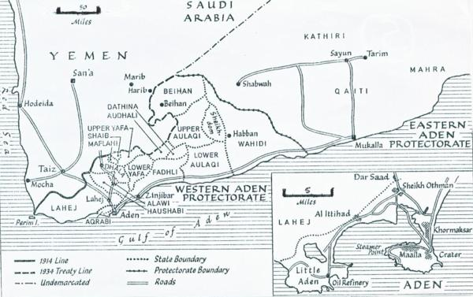
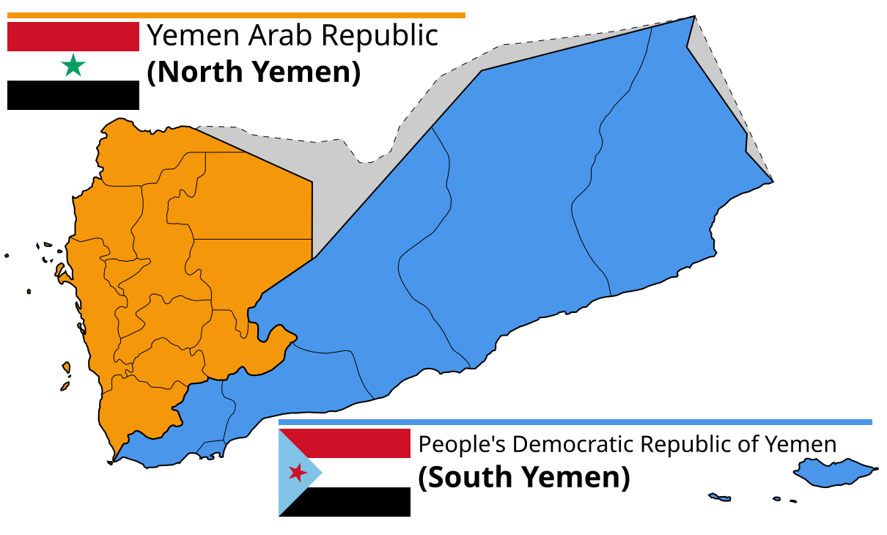
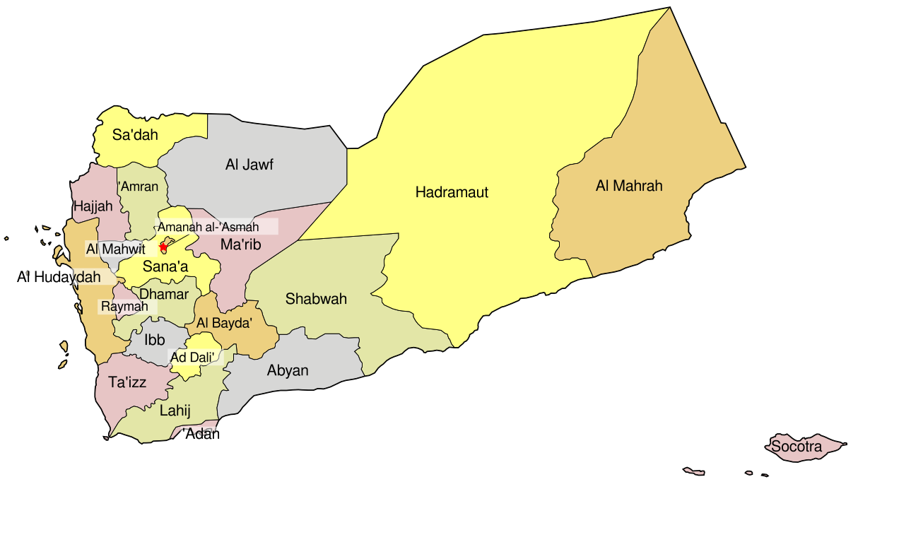
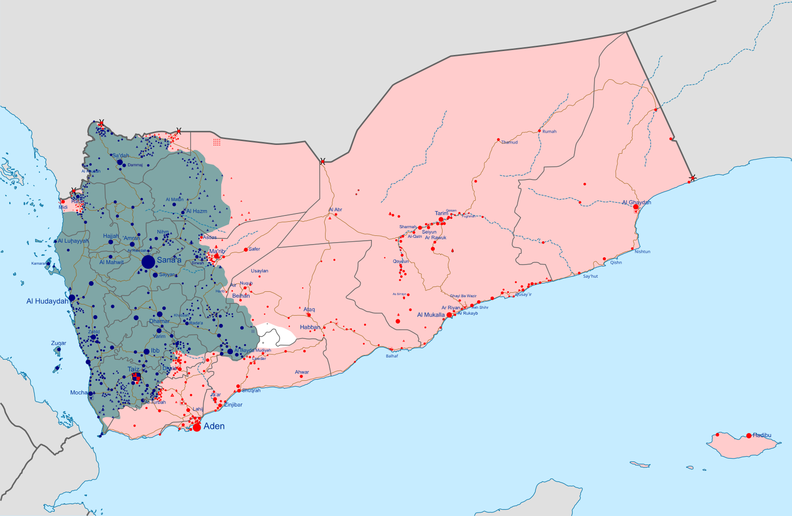

# DSAN 6000 Homework 6: Serverless S3 Bucket Queries with AWS Athena

**Due Sunday, October 18, 11:59pm EDT**

> [!WARNING]
> If you have cloned the repository **template** from the `https://github.com/jpowerj/dsan6000-hw06` URL, you are **not starting the assignment correctly!** That is, if the command you used to clone the repo onto EC2 looks like:
> 
> `git clone https://github.com/jpowerj/dsan6000-hw06`
> 
> This will **not work** for assignments in this course, since you **will not be able to push your changes** back to this repository! (Notice how the above code purposefully has *no copy button!*) Instead, you need to create your **own *private* version of the template** (shared with instructors only), as described in the next section.

### Creating Your Own *Private* Repo From the Template

Click the **green "Use this template" button** in the upper-right corner of the template repo on GitHub, then choose the "Create a new repository" option. On the next page, you will be able to create a **new repository** in **your own GitHub account**. Follow these steps to set up your new private repository:

1.  Within the **"1. General"** section, call it **`dsan6000-hw06`** (the same name as the template), and
1.  Within the **"2. Configuration"** section, choose **Private**
1.  Click the green **Create Repository** button
1.  Once the repository has been created, open the **Settings** page linked at the top of the GitHub interface
1.  In the menu on the left side of the Settings page, within the **"Access"** section, click **"Collaborators"**
1.  Use the **"Manage access"** portion of this Collaborators page to add the course instructors via our GitHub usernames, given in the following table:

<table>
<thead>
</thead>
<tbody>
<tr>
<td>Jeff</td>
<td>
  
```
jpowerj
```

</td>
</tr>
<tr>
<td>Samyu</td>
<td>

```
samyu-vakkalanka
```

</td>
</tr>
<tr>
<td>Fangzhou</td>
<td>

```
fangzhou-wang
```

</td>
</tr>
<tr>
<td>Siru</td>
<td>

```
siruwuu
```

</td>
</tr>
</tbody>
</table>

Once this **derived** private repository has been set up on **your GitHub account**, and you have added the instructors as collaborators, you are all set up to **submit the URL for your newly-created repository on Canvas!** Please submit the URL immediately after creating the repo: this is what will allow us to see your progress and check any issues between distribution and submission.

Then, once you have submitted the URL on Canvas, **clone *your* newly-created repository (*not* the template owned by `jpowerj`) to your EC2 instance to begin working!** In other words, the command you run on EC2 should look as follows (with your GitHub username in place of `YOUR_GH_USERNAME`):

```bash
git clone https://github.com/YOUR_GH_USERNAME/dsan6000-hw06
```

Note that this and other `git` commands interacting with your GitHub repository will likely require you to use a GitHub **Access Token** in place of your password (despite the fact that `git` will ask you for your password, the password you use to log into your GitHub account in your browser typically will *not* work within the `git` command-line interface).

To create this Access Token, **follow the instructions [here](https://docs.github.com/en/authentication/keeping-your-account-and-data-secure/managing-your-personal-access-tokens#creating-a-personal-access-token-classic)**: you can just check off all permissions (since this is a case of you "granting" permissions to yourself – you would need to worry about specific permissions if you were granting access to a coworker on a project, for example!), and you don't need to choose an expiration date for this Access Token (though you can for extra account security).

## HW6 Task: Direct Queries on an S3-Based Data Lake

### Background

The dataset you'll be working with for this assignment is the global "High-Resolution Settlement Layer", a dataset constructed by Columbia's [Center for Integrated Earth Systems Information (CIESIN)](https://ciesin.columbia.edu/) where each row represents a tiny (30m-by-30m) "grid cell" on the surface of the earth<a name='fn1loc'></a><sup>[1](#fn1)</sup>, and the columns represent some statistically-inferred demographic information about that grid cell: for this assignment, we're focusing on the estimated **population** for various subgroups (men, women, youth under age 5, elderly over age 60, etc.) within this cell.

There are lots of important social-scientific reasons for utilizing these grid-based estimates, as a complement to the "standard" ways of chopping up territories that you might expect as the default choice: countries, states, provinces, etc... Since this isn't a social science course, however, I'll just quickly highlight two core factors that motivate the analyses in this assignment.

### (1) Rapid Movement Across Political Boundaries

The first factor is just that, with [117.8 million forcibly-displaced people](https://www.unhcr.org/refugee-statistics) in the world as of 2026 (and with this number growing each year), population groups shift rapidly on a day-to-day basis *across* the "standardized" geographic boundaries of countries and provinces.
  
With these population movements happening far too rapidly for a census to track (think of how, e.g., the US Census is only conducted once every 10 years), modern approaches to refugee aid provision instead use [remote sensing](https://en.wikipedia.org/wiki/Remote_sensing) – especially photos taken from satellites – to detect collections of pixels in these photos that might be indicative of new human activity (hence the "Settlement Layer" in the name of the dataset). This does not eliminate the usefulness of censuses, however! Census estimates, when available, provide crucial **Bayesian priors** that are then updated based on the observed satellite imagery.

### (2) Insufficiency of Census Data

The second factor is that, on the topic of **censuses**, there are also major conflicts in the world (producing large proportions of the 117.8 million forcibly-displaced) in countries which **purposefully do *not* conduct censuses**, for avowedly political reasons.
  
One famous example is **Lebanon**, the country whose political events (in ACLED) you analyzed at the end of HW5! The last "official" census ever conducted in Lebanon took place in 1932, when it was still a French mandate, and its results were used to construct a quota-based presidential-parliamentary system striking a "delicate balance" among Lebanon's... dizzying array of [ethnic and religious populations](https://en.wikipedia.org/wiki/Demographics_of_Lebanon#/media/File:Lebanon_religious_groups_distribution.jpg).

Since that time [crunching an entire country's history into one sentence], no administration since its 1943 independence from France has found it wise to "upset" this "delicate balance" by conducting a new census. Thus, for aid-delivery purposes, data derived from grid cells via satellite imagery is crucial for understanding the population landscape of Lebanon.

Thinking counterfactually, and striving to find comparisons to test claims like *"we shouldn't conduct another census since it would spark a civil war"*, we can also look at Nigeria, where a history book like Eghosa Osaghae's [*Crippled Giant: Nigeria Since Independence*](https://www.dropbox.com/scl/fi/4e2kxfhpfks4j25obamaj/Crippled-giant-_-Nigeria-since-independence.pdf?rlkey=m4pjscx0t8v78vbfyfniu3xco&dl=1) has a section on "The Census Crisis" of 1963 as an early catalyst for [Civil War](https://en.wikipedia.org/wiki/Nigerian_Civil_War) 4 years later.

### The Data Lake Infrastructure

With the choice of this particular data motivated in the previous section, the link with the DSAN 6000 material comes from **how this data is stored**: CIESIN updates the data each month (though you can think about how you might ensure that your analysis here is *scalable* to more frequent weekly or daily updating!), and simply "tosses" a snapshot of that month's data into an S3 bucket, giving rise to a **Data Lake pattern**.

If the use of this buzzword is still confusing (as it is to me), keep in mind the distinctions between this pattern and a **Data Warehouse pattern**:

* If CIESIN used the Data Warehouse pattern, they would instead add the monthly data to a **table** within **structured database** using an **SQL command** like `INSERT INTO <table>`.

  This would then force them into a **schema-on-write** situation: if the data they tried to write into the table with that SQL command did not match the **schema** of the table (for example, if they tried to store the latitude as a string like `"40°41′42″ S"` when the table was expecting a `FLOAT`), it would be rejected.
  
* Instead, by using S3 bucket storage here, CIESIN is able to place arbitrary sequences of bytes (bundled together as **objects**, hence "object storage") into the bucket each month.
  
  As mentioned in class, this may seem "nice and easy" from the perspective of the data *producer*: no data will ever be rejected when written into the S3 bucket, since it does not enforce a schema! However, it simply passes the issue forwards in time to the data *consumer*, since it gives rise to a **schema-on-read** setup: someone using the data in the future may indeed find one month where latitudes are stored as strings like `"40°41′42″ S"`, and another month where the same latitude is stored as `-40.69500`.

As we've discussed, these are the kinds of issues that arise when moving from OLTP to OLAP that the `.parquet` format aims to alleviate, since `.parquet` files can be stored in an S3 bucket arbitrarily as needed, while still containing their own **schema information** in their within-file metadata footers.

But alas, CIESIN has not adopted the `.parquet` format in this case (for reasons vaguely related to the additional complexities of storing *geospatial* data as opposed to "standard" tabular-numeric data): instead they are in old-school **tsv** format, so we'll need to take that into account as we set up our **Athena connection** to their S3 bucket!

## Part 1: Querying Yemen Data

At the end of HW5, when you subsetted the collection of *all* ACLED events to just the events in **Lebanon**, you it turned out that the 34,122 events recorded for that country were small enough to fit within the RAM of your EC2 instance, motivating your use of `.collect()` followed by `.lazy()` on the collected data to *cache* it within RAM.

Within that same dataset, 108,383 events are recorded for **Yemen**, more than three times the count for Lebanon. Thus we might imagine a scenario where Lebanon's data *can* fit locally in RAM whereas Yemen's *cannot*. And, even if both can fit, remember that we're conducting our analytics here to be **scalable!** We don't know how many new events might be recorded on a given day in either case, especially in light Israel's ongoing [bombardment of southern Lebanon](https://www.nytimes.com/interactive/2026/10/12/world/middleeast/israel-lebanon-destruction.html) and the ongoing [Yemeni Civil War](https://en.wikipedia.org/wiki/Yemeni_civil_war_(2014%E2%80%93present)).

Thus, although in the next part we'll "zoom out" to queries across the entire globe, in this part we'll imagine looking at those 108,383 events in Yemen and trying to identify possible **relationships** between the events and Yemen's underlying demographic landscape: do the events happen more often in regions with disproportionately-many young children, for example?

The last census conducted in Yemen was in 2004, and modern estimates have to be [inferred from this 22-year-old data](https://data.humdata.org/es/dataset/yemen-population-estimates/resource/5a3cb3f9-5148-4f5d-b269-f50c5a81a2d3), meaning that they become less and less reliable over time (especially given the acceleration of forcible displacement after the start of the Civil War in 2014). So, let's use **Athena** to carry out some basic analytics of the population, not based on inferences from 2004 but instead based on the remotely-sensed CIESIN estimates!

### Question 1.1 (Code Provided): An Overall Population Estimate

First things first, you will need to set up your **Athena Console**, within the **AWS Console** web UI, to carry out queries on the S3 bucket. The bucket containing the Yemen data is located at the following URI:

```
s3://dsan6000-hrsl/yemen-2020/
```

The setup in this case is mostly the same as the setup used in the [Athena demo](https://jjacobs.me/dsan6000/writeups/athena/) at the end of Week 6, but with the additional complexity of a **hive-partitioned** folder structure. So, in this case you should set up Athena as follows:

1.  If it's not the default page that you see when you navigate to the Athena Console, use [this link](https://us-east-1.console.aws.amazon.com/athena/home?region=us-east-1#/query-editor) to navigate to the Athena **Query Editor**. This is the UI which... basically just contains a big textbox allowing you to enter and run SQL queries on data stored in S3 buckets.

    However, the panels on the **left side** of this interface are a bit misleading: despite its name, the **Data** panel is not the important one here. The important panel is beneath it, **Tables and views**, where you should click **Create** then **S3 bucket data**, which should open up the "Create table from S3 bucket data" page.

2.  The **Table name** can be whatever you'd like (I called it `yemen_2020`), and under **Database configuration** you can just choose the default, or give it a new name if you'd like (this is somewhat like how DuckDB always has a "default" database ready for you to use, created right when it is launched).

After those two steps, the rest of the information here is up to you to figure out, from the above info along with the schema, which you should derive from the following info:

* The contents of the files in the S3 bucket, despite the `.csv` extension, are in fact **tab-separated values**, delimited by the `\t` character
* Within each file, there are four columns you'll need to worry about, since you'll use them in your queries. In order, these are:
  * `latitude`: a `float` value representing the *first* coordinate of the *center* of the grid cell,
  * `longitude`: a `float` value representing the *second* coordinate of the *center* of the grid cell,
  * `population`: a `float` value representing the estimated population within that cell, and
  * `adm1`: a `string` value containing the name of the "first administrative division" that the center of the grid cell lies within (within Yemen these are called *"Muhafazat"*, or "Governorates", with the exception of Sana'a *City* which is separated from the Sana'a Governorate around it. So, if the center lies within this city, its `adm1` value will be `"Sana'a"` – note the apostrophe, which you'll need to handle in your queries below!)
* Then, the last thing to note is that the data was **Hive-partitioned** based on a (categorical) `string` variable called `type`: this brings the file sizes down from GBs to MBs, and saves lots of potential computation time if you know in advance which of the following demographic groups you want to obtain estimates for. Alphabetically, the possible values are:
  * `"children_under_five"`
  * `"elderly_sixty_plus"`
  * `"men"`
  * `"total_population"`
  * `"women_of_reproductive_age_15_49"`
  * `"women"`
  * `"youth_15_24"`

Since you will need to know the exact `adm1` values for some of the queries below, these are reproduced in the following table:

| adm1             | GID_1    | GID_0   | COUNTRY   | NL_NAME_1     | TYPE_1    | ENGTYPE_1   |
|:-----------------|:---------|:--------|:----------|:--------------|:----------|:------------|
| Aden             | YEM.1_1  | YEM     | Yemen     | عدن           | Muhafazah | Governorate |
| Abyan            | YEM.2_1  | YEM     | Yemen     | أبين          | Muhafazah | Governorate |
| Al Bayda'        | YEM.3_1  | YEM     | Yemen     | البيضاء       | Muhafazah | Governorate |
| Al Dali'         | YEM.4_1  | YEM     | Yemen     | الضالع        | Muhafazah | Governorate |
| Al Hudaydah      | YEM.5_1  | YEM     | Yemen     | الحديده       | Muhafazah | Governorate |
| Al Jawf          | YEM.6_1  | YEM     | Yemen     | الجوف         | Muhafazah | Governorate |
| Al Mahrah        | YEM.7_1  | YEM     | Yemen     | المهره        | Muhafazah | Governorate |
| Al Mahwit        | YEM.8_1  | YEM     | Yemen     | المحويت       | Muhafazah | Governorate |
| Amanat Al Asimah | YEM.9_1  | YEM     | Yemen     | أمانة العاصمة | Muhafazah | Governorate |
| Amran            | YEM.10_1 | YEM     | Yemen     | عمران         | Muhafazah | Governorate |
| Dhamar           | YEM.11_1 | YEM     | Yemen     | ذمار          | Muhafazah | Governorate |
| Hadramawt        | YEM.12_1 | YEM     | Yemen     | حضرموت        | Muhafazah | Governorate |
| Hajjah           | YEM.13_1 | YEM     | Yemen     | حجه           | Muhafazah | Governorate |
| Ibb              | YEM.14_1 | YEM     | Yemen     | إب            | Muhafazah | Governorate |
| Lahij            | YEM.15_1 | YEM     | Yemen     | لحج           | Muhafazah | Governorate |
| Ma'rib           | YEM.16_1 | YEM     | Yemen     | مأرب          | Muhafazah | Governorate |
| Raymah           | YEM.17_1 | YEM     | Yemen     | ريمة          | Muhafazah | Governorate |
| Sa'dah           | YEM.18_1 | YEM     | Yemen     | صعدة          | Muhafazah | Governorate |
| Sana'a           | YEM.19_1 | YEM     | Yemen     | صنعاء         | City      | City        |
| Shabwah          | YEM.20_1 | YEM     | Yemen     | شبوة          | Muhafazah | Governorate |
| Ta'izz           | YEM.21_1 | YEM     | Yemen     | تعز           | Muhafazah | Governorate |

Once you have finished filling out the relevant information, clicking **"Create table"** will bring you back to the main query editor. You'll see a new query, the table creation query, which it will also run automatically.

If all went as planned, you will get a "successful query" message. However, there is **one more step** you'll need to carry out: if you interpreted the above schema as intended, the data in the **files themselves** are ready for querying, but Athena needs to scan the scan the "folder structure" within the bucket to detect and update its **data catalog** for efficient querying of the **Hive-partitioned** `.csv` files.

To accomplish this, use the "Tables" listing within the **Tables and views** panel in the bottom left, where you should see your newly-created table (as mentioned above, in my case it's called `yemen_2020`): click the three-dots icon to the right of the table name, and then choose **Load partitions** from the dropdown menu that appears.

All this does is load the following new query into the query editor, and automatically runs it for you (`MSCK` is short for "Metastore Check", if you're curious):

```sql
MSCK REPAIR TABLE `yemen_2020`;
```

If this completes successfully, you should see a message at the bottom indicating that it has detected the different possible `type` values, which means you are fully ready to query the contents of the S3 bucket using SQL, just as if it was a full-on relational DB (like you'd have in a Data Warehouse setup)!

Since that was a lot of work, here we provide the first query for you. Copy and paste the following query into the query editor and then click the orange **Run** button:

```sql
SELECT
  min(latitude) AS min_latitude,
  min(longitude) AS min_longitude,
  max(latitude) AS max_latitude,
  max(longitude) AS max_longitude,
  cast(sum(population) as integer) AS population
FROM yemen_2020
WHERE type='total_population';
```

If your table was set up correctly, this should produce a **table of results** below the query editor, which should just have one row containing the minimum and maximum latitude and longitude values across all queried data (this is just for sanity-checking purposes), along with a **total population estimate** of 26,832,212.

This is below the UN-estimated 2020 population of about 30 million (computed from the dataset [cited above](https://data.humdata.org/es/dataset/yemen-population-estimates)), but it may actually be more accurate, since it is very difficult to model population outflows during civil wars solely by extrapolating from earlier censuses (i.e., without this satellite imagery)!

### Question 1.2: The Aden Protectorate vs. The Sana'a Imamate

We now return to the scenario described above, where you're a researcher hoping to analyze whether **demographic factors** might explain the presence or absence of political violence across different regions of Yemen.<a name='fn2loc'></a><sup>[2](#fn2)</sup>

As discussed in [this paper with more citations than any paper I've ever seen in my PhD field](https://scholar.google.com/scholar?hl=en&as_sdt=0%2C9&q=acemoglu+colonial+origins+of+comparative+development&btnG=), colonial institutions typically have a strong impact on subsequent trajectories (in terms of "development" as well as political conflict). So, let's quickly take a look at how we might set up a query examining sub-regions of Yemen with differing **colonial histories**.

As you can see in the map below from the 1930s, there was a key road leading from **Mocha** (yes, it's actually where mocha frappuccinos come from!) to **Sana'a**, the current capital of Yemen and also the capital of the [**Imamate of North Yemen**](https://en.wikipedia.org/wiki/Kingdom_of_Yemen), which was technically **independent of** Britain. On the other hand, at the bottom of the map you can see the [**Aden Protectorate**](https://en.wikipedia.org/wiki/Aden_Protectorate), a territory ruled directly by Britain from 1839 until 1967.

<p align="center" width="100%">
    </img><br>
    <a href='https://www.tandfonline.com/doi/full/10.1080/03086534.2015.1123976'><i>Image Source</i></a>
</p>

Given this background, a researcher might be interested in comparing demographic information between **Sana'a** in the north and **Aden** in the south... And that researcher in this case is you!

Modify the query from Question 1.1 so that, instead of summing the `total_population` estimates across the entirety of Yemen, it sums these estimates **separately** for **Sana'a** and **Aden**. That is, in place of the single row in the result from Question 1.1, you should now have **two** rows, one per `adm1` value (make sure that these `adm1` values are also returned as columns in the results, so that graders can tell which row represents which region!)

Copy-and-paste the **SQL expression** you write for this task into a file called `YEM_capitals.sql`, and include it as part of your repo when pushing to GitHub.

Then, once you have **run** the query within the Athena web UI, and successfully obtained the results, click the "Download results CSV" button above the results table to download the result as `.csv`. Include this file in your repo as `YEM_capitals_result.csv` (rather than the randomly-generated UUID that is used by default for the downloaded file!), and make sure it is included when pushing your repo to GitHub.

### Question 1.3: PDRY vs. YAR

As might have been anticipated in light of these differing colonial experiences, the "era of decolonization" after World War II again gave rise to different political regimes in the north and south of the country. While anti-*monarchical* forces in the **north** deposed the imam and established the **Yemen Arab Republic (YAR)** in 1962, aligned with Gamal Abdel Nasser's pan-Arab nationalist regime in Egypt, anti-*colonial* forces in the south fought for 5 more years before achieving independence from Britain in 1967.

At that point, since the revolutionaries in the south espoused a *communist* rather than *pan-Arab-nationalist* agenda for Yemen's future, they opted *not* to unite with the YAR, instead establishing the Marxist-Leninist **People's Democratic Republic of Yemen (PDRY)** and forming close relationships with the Soviet Union and Cuba.

<p align="center" width="100%">
    </img>
</p>

Given this background, a researcher might be interested in comparing the relative **elderly** and **young** populations of two sub-regions of modern Yemen corresponding to the two former countries: since the countries re-united to form a single nation in 1990, the **youth** across both regions may have a shared Yemeni-nationalist ideology, whereas the **elderly** may be more divided along the former pan-Arab vs. communist lines.<a name='fn3loc'></a><sup>[3](#fn3)</sup>

The following code provides a (rough) mapping of the modern governorates of Yemen to the pre-unification country they belonged to (as Python code, but, hopefully still helpful for copying-and-pasting into your SQL query!)

```python
part_map = {
  "YAR": [
    "Al Bayda'", "Sana'a", "Al Dali'", "Al Hudaydah", "Al Jawf",
    "Al Mahwit", "Amanat Al Asimah", "Amran", "Dhamar", "Hajjah",
    "Ibb", "Ma'rib", "Raymah", "Sa'dah", "Ta'izz",
  ],
  "PDRY": [
    "Aden", "Abyan", "Al Mahrah", "Hadramawt", "Lahij", "Shabwah",
  ]
}
```

Use this mapping to construct a query in the Athena query editor for obtaining the **total elderly (60+) population** and **total youth (15-24) population** living in the former YAR and the former PDRY (separately). The result of your query should be a table with **four rows**, two for the elderly populations and two for the youth populations of the two regions. The rows should be **sorted** (**ordered**) first by the `type` variable (`"elderly_60_plus"` then `"youth_15_24"`) and then by the acronyms of the former countries (`"PDRY"` then `"YAR"`).

Copy-and-paste the **SQL expression** you write for this task into a file called `YEM_youth_elderly.sql`, and include it as part of your repo when pushing to GitHub.

Then, once you have **run** the query within the Athena web UI, and successfully obtained the results, click the "Download results CSV" button above the results table to download the result as `.csv`. Include this file in your repo as `YEM_youth_elderly_result.csv` (rather than the randomly-generated UUID that is used by default for the downloaded file!), and make sure it is included when pushing your repo to GitHub.

### Question 1.4: Your First Optimized Geospatial Query!

As you may be abe to tell by quickly looking back and forth between (or overlaying) the above pre-1990 map and the following present-day map, the post-1990 governorates in fact do **not** perfectly map onto the pre-1990 divisions within each country!

<center>

</img>

</center>

While you *could* take the GIS class and learn how to carry out a full-on [areal-weighted interpolation](https://jjacobs.me/ppol6805/writeups/interpolation/) (which some of yall are doing, in which case you just learned how this method works!), here we'll take a simpler approach: taking the present-day map of Yemen and simply **drawing** the former PDRY boundaries onto it! (You could then repeat this process for the YAR, but for the sake of this question I think just one query can suffice for grasping the concept!)

Clicking the following link should open up the "default" world map on geojson.io, and then it should specifically zoom in on Yemen (if it seems too zoomed-out... the island of [Socotra](https://en.wikipedia.org/wiki/Socotra) is part of Yemen despite being far offshore to its southeast!):

> [**https://geojson.io/?map=5.89/15.9964/47.50562**](https://geojson.io/?map=5.89/15.9964/47.50562)

Within the geojson.io interface, click the hexagon icon in the upper-left to start **drawing a `POLYGON` onto the map**, doing the best you can to trace out the boundaries of "mainland" PDRY (meaning, you don't need to include Socotra). In GIS world, a `POLYGON` is just a sequence of coordinates that **begins** and **ends** with the same coordinate, so that in the interface you can either "loop" outwards from your starting point and then return by clicking on the same point you started at, or just press enter when you're tired of clicking coordinates, to complete the drawing.

You are not being graded on the accuracy of your drawing! The goal is just to see how even these fancy **arbitrary geospatial queries** (arbitrary in the sense of not matching any pre-existing administrative division within the dataset) are optimized by Athena's query optimization engine to ensure that **only the necessary data** (in this case, only the necessary grid cells) is retrieved and added to the overall population sum.

Once you have finished drawing the `POLYGON`, you should see a **"Feature Editor"** panel appear at the bottom of the interface. Open this panel up, then click on the **"Export"** tab on the right side. Of the three options in the dropdown box (WKT, GeoJSON, and BBOX), you can just use the default WKT option – click the **copy** button to the right of this dropdown box, and you have all of the information about your `POLYGON` now on your clipboard, ready for pasting back in the Athena interface!

For the time being, however, just paste the WKT string somewhere accessible to you (in a new text file, for example, or a sticky note on your desktop). Return to the Athena query editor and paste the following code:

```sql
SELECT
  min(latitude) AS min_latitude,
  min(longitude) AS min_longitude,
  max(latitude) AS max_latitude,
  max(longitude) AS max_longitude,
  cast(sum(population) as integer) AS population
FROM yemen_2020
WHERE
  type='total_population'
  AND ST_Within(
    ST_Point(longitude, latitude),
    ST_Polygon('<Your WKT string here>')
  );
```

If all went as planned, you should now see a result table with a single row, wherein the **population** column represents the estimated number of people living specifically within the `POLYGON` you drew in geojson.io!

Copy-and-paste the **SQL expression** you wrote for this task into a file called `YEM_polygon.sql`, and include it as part of your repo when pushing to GitHub.

Then, once you have **run** the query within the Athena web UI, and successfully obtained the results, click the "Download results CSV" button above the results table to download the result as `.csv`. Include this file in your repo as `YEM_polygon_result.csv` (rather than the randomly-generated UUID that is used by default for the downloaded file!), and make sure it is included when pushing your repo to GitHub.

## Part 2: Querying Global Data

Given that the data you've been analyzing – restricted just to the relatively tiny country of Yemen – already requires several GB, the notion of querying high-resolution settlement layer data across the entire *globe* should hurt your brain a bit, but should also help motivate why this task is especially well-suited to technologies we've been learning like **DuckDB**, **Polars**, and **Athena**, which enable analytic queries (like those you carried out in Part 1) without requiring all of the data to fit in RAM!

So, in this part, you will "zoom out" from the approach you took in Part 1, and query **across multiple countries**, with Athena's query optimizer making sure that you only pay for the specific extraction and processing of data from the massive S3 bucket that is **absolutely necessary** for completing your query! You have come a long way from just downloading all data as a giant `.csv` file and filtering afterwards 😸

### Question 2.1: Querying the Arabian Peninsula

It is almost never possible to fully understand a civil war without analyzing the **international context** surrounding it! As early as 1805, for example, the US was [intervening in wars of royal succession](https://en.wikipedia.org/wiki/Battle_of_Derna_(1805)) across Ottoman territories in North Africa, and conversely Britain ended up paying the US [$15.5 million in damages](https://en.wikipedia.org/wiki/Alabama_Claims) after providing military aid to the Confederacy throughout the US Civil War.

And now we get to a beautiful aspect of the full **global** (rather than just Yemeni) version of this High-Resolution Settlement Layer data: although the estimates were *computed* by the lab at Columbia, the organization tasked with *hosting* this computed data was Meta's beautiful ["AI for Good"](https://ai.meta.com/ai-for-good/docs/methodology-high-resolution-population-density-maps/) lab. And, as it turns out, Meta and its magnanimous overlord Mark Zuckergerg cared so much about using AI for good that, in their rush to use so much AI for so much good, they skipped right over all countries whose names begin with the letters A through M, and only added countries from CIESIN's data that start with the letter N onwards (so, starting with **N**amibia), to their S3 bucket.

This is why, after ending HW5 with an analysis of events in **L**ebanon, we moved to **Y**emen in this assignment. And it's why, although we'd love to be able to conduct queries like those from Question 1 across the *entire* Arabian Peninsula, we can only analyze **Yemen**, **Oman**, and **Saudi Arabia**.<a name='fn4loc'></a><sup>[4](#fn4)</sup>

So, for this question, your task is to set up a new Athena table called `full_2020`, where instead of querying the `s3://dsan6000-hrsl/yemen-2020/` bucket you will not **directly query *Meta's* bucket** at the following URI:

```
s3://dataforgood-fb-data/csv/
```

There are two key differences between the structure of the Yemen-specific data and this full global data:

* First, the `adm1` column is no longer present, so that the entire schema *within* each `.csv` file is just `latitude`, `longitude`, and `population` (all `float` values as described above).
* Second, this data is partitioned across **multiple** variables:
  * At the first level is `month`, though this has only one possible value, `"2019-06"`
  * At the second level is `country`, with values corresponding to each country's [ISO-3 code](https://en.wikipedia.org/wiki/List_of_ISO_3166_country_codes#Current_ISO_3166_country_codes)
  * Finally, as was the case for the `yemen-2020` bucket, the lowest level which actually contains the `.csv` files themsleves is partitioned based on `type`, with the same possible values as in Question 1 (`"children_under_five"`, `"elderly_60_plus"`, `"men"`, `"total_population"`, `"women_of_reproductive_age_15_49"`, `"women"`, `"youth_15_24"`)

So, with these changes in mind, your task is to set up Athena to enable queries on this Meta-hosted bucket, and then use the ISO-3 country codes linked above to write a query **estimating the total combined population of Yemen, Oman, and Saudi Arabia**.

Copy-and-paste the **SQL expression** you write for this task into a file called `arabian_peninsula_total.sql`, and include it as part of your repo when pushing to GitHub.

Then, once you have **run** the query within the Athena web UI, and successfully obtained the results, click the "Download results CSV" button above the results table to download the result as `.csv`. Include this file in your repo as `arabian_peninsula_total_result.csv` (rather than the randomly-generated UUID that is used by default for the downloaded file!), and make sure it is included when pushing your repo to GitHub.

### Question 2.2: Ja'fari Shi'a within Saudi Arabia

Just as you used geojson.io to "scoop out" a subregion of modern Yemen that doesn't correspond directly to any administrative division in Question 1.3 above, here your task will be to estimate the population of a small eastern piece of Saudi Arabia historically inhabited by so-called "Twelver" **Ja'fari** Shi'a Muslims, the pink-colored region you can see to the west of Bahrain in the [**very-zoomable very-detailed map here**](https://gulf2000.columbia.edu/images/maps/Islam_Branches_in_Middle_East_lg.png) (the religious affinities and differences between this group and the "Zaidi" Shi'a of North Yemen from Question 1.2 are... far outside the scope of this course, but are important world-understanding-wise!)

Clicking the following link should open upon geojson.io and then zoom the map in to encompass the total area of the three countries we're analyzing within the Arabian Peninsula:

> [**https://geojson.io/?map=4.29/22.51273/45.38574**](https://geojson.io/?map=4.29/22.51273/45.38574)

So, from there, zoom in on the eastern portion of Saudi Arabia and draw the Ja'fari-populated region from the map linked above as best as you can, then use the **Feature Editor** as you did in Question 1.4 to copy the WKT string to your clipboard! Once again, you are *not* being graded based on your drawing abilities – any `POLYGON` that vaguely captures this eastern region will be given full credit.

Return to the Athena query editor and use this WKT string just as you did in Question 1.4 to **query just the total population of this sub-region**. To save a bit more of your $50 balance, you can modify your query from Question 2.1 to manually restrict it to just Saudi Arabia,  but this is not required for completion!

Copy-and-paste the **SQL expression** you wrote for this task into a file called `baharna.sql`, and include it as part of your repo when pushing to GitHub. (The term ["Baharna"](https://en.wikipedia.org/wiki/Baharna) generally denotes the ethnoreligious population of Shi'a Arabs broadly spread across Eastern Arabia and Bahrain).

Then, once you have **run** the query within the Athena web UI, and successfully obtained the results, click the "Download results CSV" button above the results table to download the result as `.csv`. Include this file in your repo as `baharna_result.csv` (rather than the randomly-generated UUID that is used by default for the downloaded file!), and make sure it is included when pushing your repo to GitHub.

## HW6 Submission

You made it! Thank you for your patience in working through this assignment (with, admittedly, much much more reading than usual).

Since you submitted your GitHub URL all the way up at the top of the instructions, all that is left is for you to **push your work from EC2 to GitHub**. If you push a commit with the commit message **"Final submission"** (by running `git commit -m "Final submission"` and then `git push`), we will consider your repo ready to grade – otherwise, if no commit with this message is found, we will consider the **most recent commit when the due date is reached** to be your final submission.

---

<a name="fn1">1</a>. For the GIS folks (who know that the Earth is slightly "wider" than it is "tall"!), the real grid being used is 1 [*arcsecond*](https://support.esri.com/en-us/gis-dictionary/arcsecond) by 1 arcsecond: a single *degree* of latitude is subdivided into 60 arcminutes, and each of these arcminutes is in turn divided into 60 arcseconds. Then, near the equator, moving 1 arcsecond corresponds to a movement of [about 30 meters](https://www.opendem.info/arc2meters.html), hence the "simplified" metric grid here. [↩︎](#fn1loc)

<a name="fn2">2</a>. Once again, since this is not a social science class, we won't actually do the additional work of "linking" the ACLED data with the demographic data we're analyzing in this assignment. But, for your **final projects**, this is the kind of final step that you could carry out once you've tackled the core DSAN 6000 problem ("the size of the data is part of the engineering problem")! [↩︎](#fn2loc)

<a name="fn3">3</a>. Again pulling the not-a-social-science-class card here... in reality this hypothesized elder-versus-youth divide is probably quite far down the list of important factors for understanding the present-day Civil War. But, in the absence of more in-depth data on things like occupation, linkages with various religious movements, family connections to Saudi Arabia and/or the UAE, and so on, this is what we can explore here! Remember that a key part of science is actually *testing* our hunches about what is and is not important! Also note that the former PDRY-YAR divide *does* nonetheless bear a pretty striking resemblance to the following somewhat-up-to-date (September 2026) map of who controls what in the Yemeni Civil War: [↩︎](#fn3loc)

<p align="center" width="100%">
    </img><br>
    <a href='https://commons.wikimedia.org/wiki/File:Yemeni_Civil_War.svg'><i>Image Source</i></a>
</p>

<a name="fn4">4</a>. At this point you may be thinking, *"but Jeff, the **U**nited Arab Emirates comes after **N**amibia alphabetically!"* ...But alas, the countries are alphabetized by their [ISO-3 codes](https://en.wikipedia.org/wiki/List_of_ISO_3166_country_codes#Current_ISO_3166_country_codes), and the UAE's code is in fact `ARE`. You are free to add Qatar to your analysis, since its code of `QAT` qualifies it for "AI for Good" usage, but Kuwait with `KWT` and Bahrain with `BHR` are disqualified from the "AI for Good" universe. With only a paltry [$1.942 Trillion USD](https://companiesmarketcap.com/meta-platforms/marketcap/) in market capitalization to work with, it's understandable why Meta sometimes has to tighten their belts and cut corners like this! [↩︎](#fn4loc)

---

Assignment hash (SHA-256): `856ca8e65743d5d34d76c8d7022624c0037ae5ffab8c943af0aeb631dfea8187`
